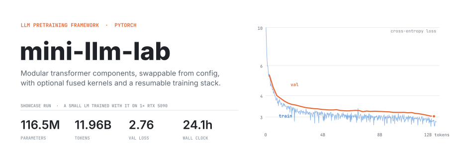
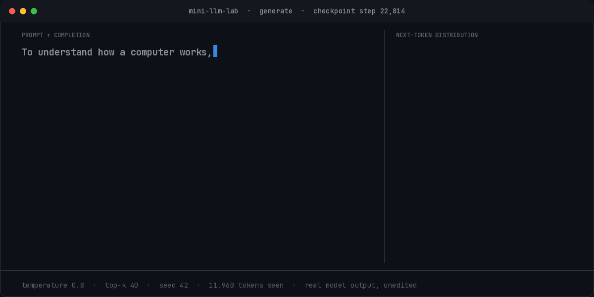
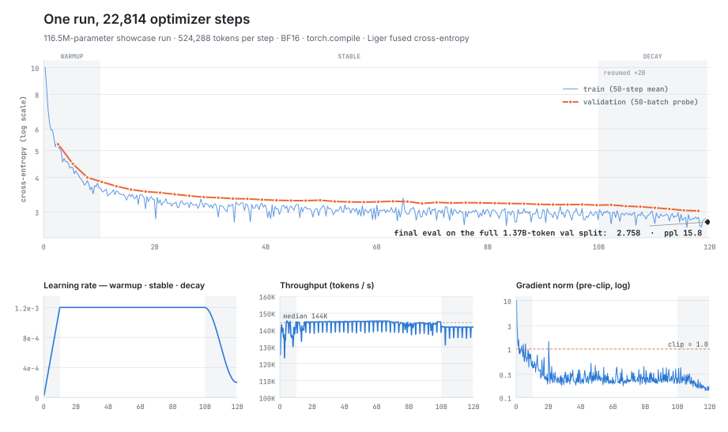
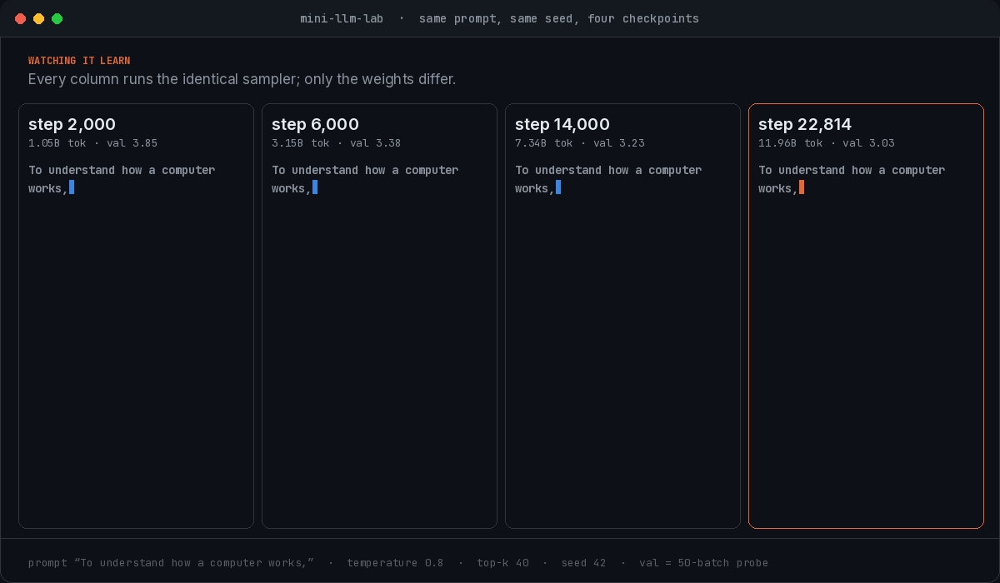
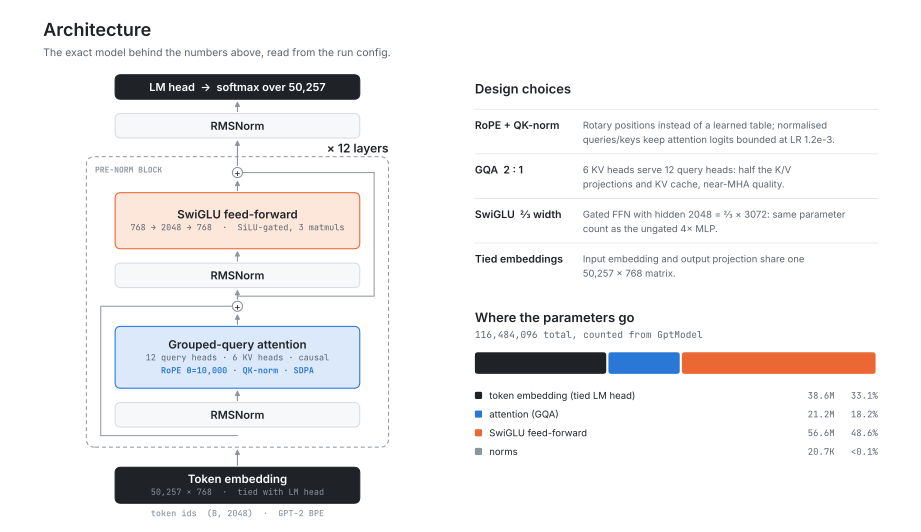
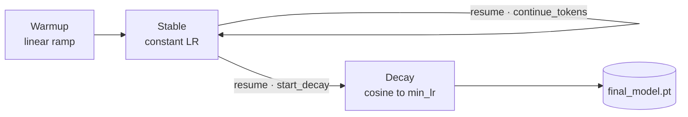
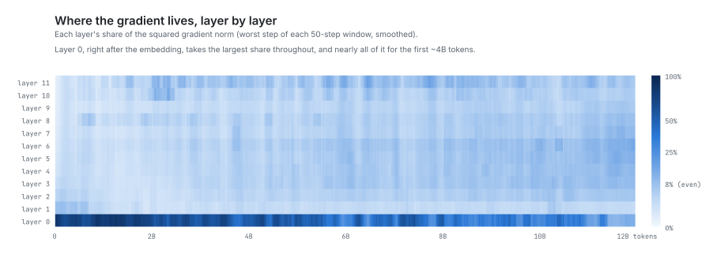
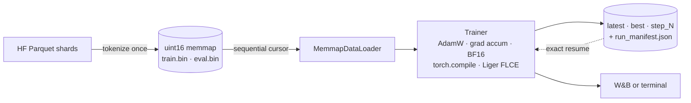

<picture>
  <source media="(prefers-color-scheme: dark)" srcset="figs/readme/hero-dark.svg">
  
</picture>

<p align="center">
  <a href="https://github.com/mohamedkhayat/mini-llm-lab/actions/workflows/ci.yml"></a>
  
  
  
  <a href="LICENSE"></a>
</p>

<p align="center">
  <a href="#whats-inside">What's inside</a> ·
  <a href="#quickstart">Quickstart</a> ·
  <a href="#showcase-a-116m-model-on-one-rtx-5090">Showcase run</a> ·
  <a href="#engineering">Engineering</a>
</p>

**mini-llm-lab is a configurable framework for pretraining decoder-only language models in PyTorch.** Every model component is implemented from scratch: multi-head and grouped-query attention, RoPE, RMSNorm, gated feed-forward layers. Each one can be swapped with a single config override. Wherever speed matters, a readable reference implementation sits next to an optional optimized path: PyTorch SDPA attention, `torch.compile`, BF16 autocast, TF32 matmuls and Liger's fused linear cross-entropy. Around the model is a complete training system: a memmap data pipeline, a two-stage WSD learning-rate schedule, bit-exact checkpoint/resume and low-overhead metrics.

To test it end to end, I used it to pretrain a 116M-parameter small language model on a single RTX 5090. [The results are below.](#showcase-a-116m-model-on-one-rtx-5090)

<p align="center">
  
</p>
<p align="center"><sub>The showcase checkpoint, sampling live. The right panel shows the model's top-5 next-token probabilities at each step; at the end, every token is shaded by its surprisal. Real model output, unedited.</sub></p>

## What's inside

### Model components

Every component is a small module under `src/models/`, selected by config key. You can ablate a single piece with one override and leave everything else untouched.

| Component | Implementations | Config key |
| --- | --- | --- |
| Attention | multi-head (`mha`), multi-head on PyTorch SDPA (`fastmha`), grouped-query (`gqa`), optional QK-norm | `model.attention`, `model.n_kv_heads`, `model.qk_norm` |
| Positions | learned absolute, rotary (RoPE) | `model.position_embedding`, `model.rope_theta` |
| Normalization | LayerNorm, RMSNorm | `model.normalization` |
| Feed-forward | GELU / SiLU / sigmoid, optionally gated (SwiGLU, GEGLU), ⅔-width parameter matching | `model.activation`, `model.gated`, `model.equalize_params` |
| Output head | tied or untied embeddings, optional bias | `model.tie_embeddings`, `model.lm_head_bias` |

Presets in `configs/model/` give starting points (`gpt2`: LayerNorm, absolute positions, GELU; `qwen`: RoPE, RMSNorm, SwiGLU), and any field can be overridden on top:

```bash
python train.py model=gpt2 model.attention=gqa model.n_kv_heads=6 model.qk_norm=true \
  model.position_embedding=rope model.normalization=rmsnorm \
  model.gated=true model.activation=silu model.equalize_params=true
```

### Reference paths and optimized paths

Each optimized path is off by default and switched on with a flag, so a reference implementation is always there to read and compare against.

| Reference | Optimized | Switch |
| --- | --- | --- |
| Explicit attention: masked `QKᵀ` → softmax → `V` | `F.scaled_dot_product_attention` (FlashAttention / memory-efficient kernels) | `model.attention=fastmha` or `gqa` |
| Eager PyTorch | `torch.compile` graph capture and kernel fusion | `training.compile=true`, `training.compile_mode` |
| FP32 | BF16 autocast, TF32 tensor-core matmuls | `training.use_bf16=true`, `training.use_tensor_cores=true` |
| LM head + cross-entropy that materializes the full `(tokens × 50,257)` logits | Liger fused linear cross-entropy: computes the loss in chunks and never materializes the full logits | `training.use_flce=true` |

### Training system

- **Two-stage WSD schedule** (warmup → stable → decay). Extend the plateau or start the cooldown from any checkpoint.
- **Bit-exact resume** of model, optimizer, scheduler, RNG and the data cursor, plus graceful `SIGINT`/`SIGTERM` handling.
- **Memmap data pipeline** that tokenizes Hugging Face Parquet datasets into `uint16` caches once.
- **On-GPU metrics** (loss, gradient norms, per-layer gradient breakdown) that never block the training loop.
- **W&B or terminal logging**, and a `run_manifest.json` that maps every checkpoint to its step, token count and validation loss.
- **A Chainlit chat UI** over saved checkpoints (`chainlit run chat.py`).

## Quickstart

Requires Python 3.12+ and PyTorch 2.10+.

```bash
git clone https://github.com/mohamedkhayat/mini-llm-lab.git
cd mini-llm-lab
pip install -e '.[dev]'

python train.py                                # CUDA, W&B logging
python train.py training.log_backend=terminal  # no W&B
python train.py training.use_flce=true         # Liger fused CE, much lower VRAM
pytest                                         # test suite
chainlit run chat.py                           # chat with saved checkpoints
```

**Try it on a laptop in ~5 seconds** (CPU, no download, no GPU):

```bash
python scripts/smoke_cache.py   # writes a tiny token cache to data/smoke/gpt2
WANDB_MODE=disabled python train.py data.hf_dataset=smoke data.max_tokens=7040 \
  model.emb_dim=128 model.n_heads=4 model.n_layers=2 model.context_length=128 \
  data.seq_len=128 training.batch_size=2 training.accum_steps=1 training.device=cpu \
  training.train_tokens=4096 training.log_backend=terminal
```

**The WSD workflow:**

```bash
python train.py training.save_interval=500                       # 1. stable phase
python train.py training.resume_from=latest \
  training.resume_mode=continue training.continue_tokens=1b      # 2. extend the plateau
python train.py training.resume_from=latest \
  training.start_decay=true training.decay_tokens=1b             # 3. decay to min_lr
```

Every option is a Hydra override (`python train.py --cfg job --resolve` prints the composed config). The [configuration reference](configuration.md) lists them all.

## Showcase: a 116M model on one RTX 5090

To stress the whole stack (every optimized path enabled, a 12B-token budget, and a mid-run resume into the decay phase), I trained a small language model from scratch on a single consumer GPU.

| | |
| --- | --- |
| **Model** | 116,484,096 parameters · 12 layers · d=768 · GQA 12q/6kv · RoPE · QK-norm · RMSNorm · SwiGLU · 2048 context |
| **Data** | 11.96B tokens of educational web + PDF text ([FinePDFs-Edu / DCLM / FineWeb-Edu mix](https://huggingface.co/datasets/HuggingFaceFW/finepdfs_edu_50BT-dclm_30BT-fineweb_edu_20BT-shuffled)), GPT-2 BPE |
| **Validation loss** | **2.758** (perplexity **15.77**, ±0.005 s.e.) on the full held-out split of 1.37B tokens |
| **Wall clock** | 24.1 h, median throughput 144K tokens/s |
| **Memory** | 20.3 GB peak with BF16, `torch.compile` and Liger fused cross-entropy |
| **Schedule** | 10B-token warmup-stable phase, then a resume into a 2B-token decay (WSD) |

<picture>
  <source media="(prefers-color-scheme: dark)" srcset="figs/readme/training-dark.svg">
  
</picture>

Validation loss keeps dropping through the long stable phase, then falls again as the learning rate anneals from 1.2e-3 to 2e-4 during the decay. Gradient norms sit well below the 1.0 clip threshold for almost all of training. The throughput dips are the periodic evaluation passes.

### Watching it learn

<p align="center">
  
</p>

All four checkpoints get the same prompt, seed and sampler. At step 2,000 the model loops on "the data can be used to store the data". By step 6,000 it can produce bulleted lists, though the content still goes in circles. At step 14,000 it has picked up the shape of a textbook ("In this book, we will learn how to:"), and the final checkpoint stays on topic with a coherent explanation.

### The model it trained

<picture>
  <source media="(prefers-color-scheme: dark)" srcset="figs/readme/architecture-dark.svg">
  
</picture>

## Engineering

**Resumable WSD phases.** A run trains at a constant LR for as long as it keeps improving. Extending the plateau (`continue_tokens`) or starting the cooldown (`start_decay`) are both resumes from any checkpoint, with no retraining. The data cache grows automatically when a later phase needs more tokens than the cache holds. The showcase run's decay phase was a resume of this kind.



**Bit-exact resume.** A checkpoint stores model, optimizer, LR scheduler, every RNG state, the global step, the memmap data cursor and the token counter. A golden test checks that an interrupted-and-resumed run matches an uninterrupted one weight for weight. Writes are atomic, and `SIGINT`/`SIGTERM` finish the current optimizer step before saving `latest.pt`.

**Metrics with no host sync.** Loss and gradient diagnostics accumulate as GPU tensors and are copied to the host once per log interval, so logging does not stall the training loop. Each interval records the pre-clip gradient norm, the number of clipped steps, micro-batch loss spikes, and a per-layer and per-module gradient breakdown at the worst step. Here is that breakdown over the showcase run:

<picture>
  <source media="(prefers-color-scheme: dark)" srcset="figs/readme/grad-layers-dark.svg">
  
</picture>

**Data pipeline.** Hugging Face Parquet shards are tokenized once into `uint16` memmaps and read sequentially in a single pass, with the cursor saved in each checkpoint.



**Tested and in CI.** More than 200 tests run on CPU, including a seeded golden loss/LR trajectory, the checkpoint-format contract, resume equivalence, schedule edge cases and the shutdown signals. On every push, [GitHub Actions](.github/workflows/ci.yml) runs ruff, the full suite, and a two-stage smoke pipeline (train → checkpoint → resume into decay) on CPU. Pushing a `v*` tag builds the package and publishes a GitHub Release.

## Project layout

```
configs/            Hydra config: data, model presets (gpt2 / qwen / moe), training
src/models/         attention (MHA, SDPA, GQA), RoPE, norms, FFN, GptModel
src/data/           tokenization, memmap cache, token budgets, loader
src/training/       trainer, WSD schedule, checkpointing, metrics, logging
tests/              200+ CPU tests, including golden and resume-equivalence checks
scripts/            smoke-test cache, throughput measurement
figs/readme/        scripts that build the README figures
train.py · chat.py  training entry point · Chainlit chat UI
```

## License

[MIT](LICENSE)
